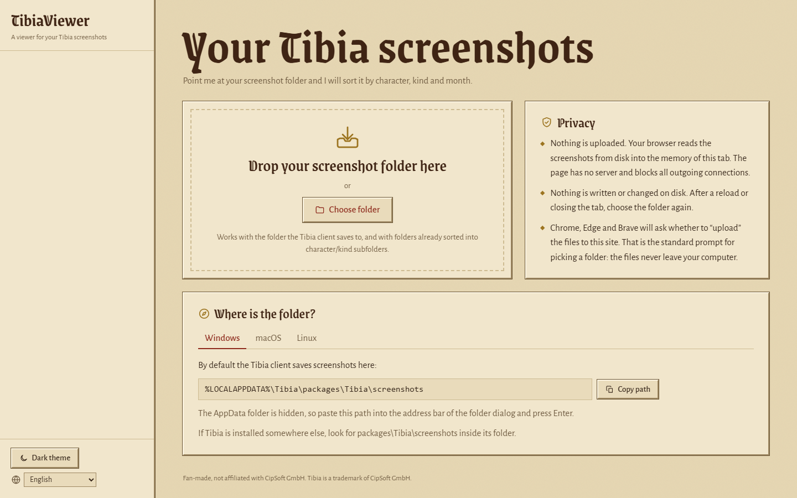

# TibiaViewer

Browse your Tibia screenshots by character, kind and month, right in your browser.
Nothing is uploaded and nothing is installed.

**Open it: <https://pavloant.github.io/tibiaviewer/>**



> Fan-made, not affiliated with CipSoft GmbH. Tibia is a trademark of CipSoft GmbH.

*[Po polsku ↓](#po-polsku)*

## How to use

1. Open the TibiaViewer page.
2. Drag your screenshot folder onto the page, or click **Choose folder**.
3. Pick a character on the left and a kind (Level up, Boss defeated, …) at the top. Click a screenshot to view it full size.

In the preview, use ← → to step through, Home/End to jump to the first or last screenshot, and Esc to close. Click the picture to toggle actual size.

TibiaViewer reads the folder only for the current tab. After a reload, choose the folder again.

### Where is the screenshot folder?

- **Windows:** `%LOCALAPPDATA%\Tibia\packages\Tibia\screenshots` by default.
  AppData is hidden, so paste that path into the address bar of the folder dialog and press Enter.
  If Tibia is installed somewhere else, look for `packages\Tibia\screenshots` inside its folder.
- **macOS and Linux:** the client saves screenshots in `packages/Tibia/screenshots` inside its data folder.
  Where that folder is depends on how Tibia was installed.
  In the folder dialog, Cmd+Shift+G (macOS) or Ctrl+L (Linux) lets you type a path, and Cmd+Shift+. or Ctrl+H shows hidden folders.

Both the client's own flat folder and a folder already sorted into `<character>/<kind>/` subfolders work.
Grouping comes only from file names, and subfolders are scanned recursively.

### What gets grouped where

Tibia names screenshots `<YYYY-MM-DD>_<HHMMSSmmm>_<Character>_<Kind>.png`, for example
`2025-07-13_183932732_Arcadio Pirales_SkillUp.png`.

- The name is split on `_` at most three times, so a kind may itself contain `_`.
- Copy suffixes such as `__2` are ignored.
- Known kinds get a translated label and an icon. Unknown ones are shown with their CamelCase split into words.
- Files that don't match the pattern go to the **Others** gallery, dated by the file's modification time.
- Only `.png`, `.jpg`, `.jpeg` and `.webp` files are read.

## Privacy

- **Nothing leaves your computer.** The browser reads the files you pick straight into the memory of the tab. There is no server, no analytics and no external fonts.
- **The browser enforces this.** The page ships a Content Security Policy with `default-src 'none'` and allows only same-origin scripts, styles and fonts, plus `blob:` images. Any attempt to send data anywhere is blocked by the browser itself.
- **Nothing is written to disk.** The theme and language are kept in `localStorage`; no screenshot data is stored.
- **About the browser prompt:** Chrome, Edge and Brave show a prompt like "Upload N files to this site?" when you pick a folder. That is the browser's standard wording for giving a page access to files. Nothing is uploaded.

## Browser support

TibiaViewer targets current desktop Chrome, Edge, Brave, Firefox and Safari. It has been tested in Edge (Chromium); reports from other browsers are welcome.

It uses only `<input type="file" webkitdirectory>` and drag and drop (`webkitGetAsEntry`), not the File System Access API. That API is off by default in Brave, and Chromium blocks it for AppData, where Tibia is installed by default.

## Performance

Thousands of screenshots (tested with 3,862 PNG files, about 9 GB) load in under a second:

- Thumbnails are made lazily for cards near the viewport with `createImageBitmap`, scaled down on a canvas, and kept as small WebP/JPEG blobs.
- At most 3 are decoded at once.
- At most 400 thumbnail URLs are alive; older ones are revoked and rebuilt when you scroll back.
- The full-size preview keeps object URLs only for the current screenshot and its two neighbours.

## Languages

The UI comes in English, Polski, Deutsch, Português (Brasil) and Svenska.
The language is picked from your browser settings and can be changed in the sidebar.

| Language | Status |
|---|---|
| English (`en`) | complete |
| Polski (`pl`) | complete |
| Deutsch (`de`) | **needs review by a native speaker** |
| Português (Brasil) (`pt-BR`) | **needs review by a native speaker** |
| Svenska (`sv`) | **needs review by a native speaker** |

The kind labels, such as "Bestiary entry completed", deserve a second look in each language, so they match what players actually say.
Corrections are very welcome.

### Adding a language

All text lives in [`assets/i18n.js`](assets/i18n.js).

1. Copy the `en` block.
2. Give it a BCP 47 key (for example `es` or `fr-CA`).
3. Translate the strings and the `reasons`.

Plural forms use [`Intl.PluralRules`](https://developer.mozilla.org/docs/Web/JavaScript/Reference/Global_Objects/Intl/PluralRules) categories (`one`, `few`, `many`, `other`, …), and dates use `Intl.DateTimeFormat`. Nothing else needs to change.

## Running locally

It's a static site with no build step. Serve the folder with any static server, for example:

```
python -m http.server 8000
```

Then open <http://localhost:8000/>. Opening `index.html` directly from disk works too.

Repository layout:

```
index.html          page shell and Content Security Policy
assets/app.js       scanning, grouping, thumbnails, viewer
assets/i18n.js      all translations
assets/app.css      styles and the two themes ("Pergamin" light, "Loch" dark)
assets/boot.js      applies the saved theme before first paint
assets/fonts/       Grenze Gotisch + Alegreya Sans (woff2, SIL OFL 1.1)
assets/icon.svg     app icon (original artwork, no CipSoft assets)
```

## License

MIT, see [LICENSE](LICENSE).

The fonts are under the SIL Open Font License 1.1: [Grenze Gotisch](https://github.com/Omnibus-Type/Grenze-Gotisch) by Omnibus-Type and [Alegreya Sans](https://github.com/huertatipografica/Alegreya-Sans) by Huerta Tipográfica.

Fan-made, not affiliated with CipSoft GmbH. Tibia is a trademark of CipSoft GmbH.

---

## Po polsku

TibiaViewer to przeglądarka screenshotów z Tibii, która działa w całości w przeglądarce. Niczego się nie instaluje i niczego się nie wysyła.

### Jak używać

1. Otwórz stronę TibiaViewer.
2. Przeciągnij folder ze screenami na stronę albo kliknij **Wybierz folder**.
3. Po lewej wybierz postać, u góry rodzaj (Nowy poziom, Pokonany boss…). Kliknij screena, żeby go powiększyć.

W podglądzie strzałki ← → przełączają screeny, Home/End skacze na początek lub koniec, a Esc zamyka. Kliknięcie obrazu przełącza rozmiar 1:1.

Folder jest wczytany tylko w tej karcie. Po odświeżeniu strony trzeba go wybrać ponownie.

### Gdzie jest folder?

- **Windows:** domyślnie `%LOCALAPPDATA%\Tibia\packages\Tibia\screenshots`.
  Folder AppData jest ukryty, więc wklej tę ścieżkę w pasek adresu okna wyboru folderu i naciśnij Enter.
  Jeśli Tibia jest zainstalowana gdzie indziej, szukaj `packages\Tibia\screenshots` w jej folderze.
- **macOS i Linux:** klient zapisuje screeny w `packages/Tibia/screenshots` wewnątrz swojego folderu danych. Jego położenie zależy od sposobu instalacji.

Działa zarówno płaski folder klienta, jak i folder już posortowany w podfoldery `<postać>/<rodzaj>/`. Grupowanie wynika wyłącznie z nazw plików.

### Prywatność

- **Nic nie opuszcza komputera.** Przeglądarka czyta wybrane pliki prosto do pamięci karty. Nie ma serwera, statystyk ani zewnętrznych fontów.
- **Pilnuje tego sama przeglądarka.** Strona ma politykę Content Security Policy, która blokuje wszystkie połączenia wychodzące.
- **Nic nie jest zapisywane na dysku.** W `localStorage` zostają tylko motyw i język.
- **Komunikat „Przesłać N plików?”** w Chrome, Edge i Brave to standardowe okno przy wyborze folderu. Pliki nigdzie nie są wysyłane.

Projekt fanowski, niezwiązany z CipSoft GmbH. Tibia jest znakiem towarowym CipSoft GmbH.
